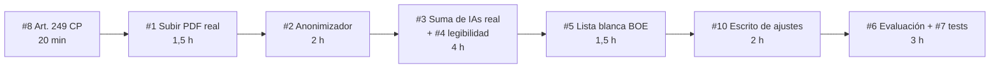

# InclusiveCourt: análisis de huecos y plan de mejoras para ganar el Reto 3

Fecha: miércoles 21 oct, 13:30. Base: `main` tras el commit `4433740`, el PDF oficial del reto ([`docs/reto/reto3-contexto.md`](docs/reto/reto3-contexto.md)) y la evaluación legal ([`docs/reto/cumplimiento-legal-rgpd.md`](docs/reto/cumplimiento-legal-rgpd.md)).

> Este documento solo cubre producto (UI/UX, frontend, backend, IA). El material de pitch queda fuera hasta que lo pidamos.

---

## 1. Dónde puntúa el jurado

| Premio | Patrocinador | Qué premiará | Dónde estamos |
|--------|--------------|--------------|---------------|
| Mejor viabilidad técnica | INECO (Ana Tudela presenta nuestro reto) | Prototipo sólido, que funciona y se puede desplegar | Bien en UI, flojo en robustez: sin tests, sin URL pública estable, la lectura de PDF falla |
| Solución más innovadora | NTT Data | Algo que no hayan visto en 2025 (SIMPLEX ya hizo "IA que explica derechos en lenguaje claro") | Sala Previa 3D, Pasaporte sin diagnóstico y la gamificación calmada nos diferencian. Lenguaje claro solo ya no basta |
| Promptathón | UDC | Extracción de información de documentos judiciales anonimizados | Tenemos el pipeline de citación, pero sin esquema validado ni métricas |

La conclusión: competimos por los tres premios con el mismo motor (`/citacion` + backend). Hay que endurecerlo y medirlo.

---

## 2. Cobertura del PDF del reto (comprobada en el código)

| Exigencia del reto | Estado | Evidencia |
|--------------------|--------|-----------|
| Preparar a la persona (TEA, TDAH, dislexia) | Cubierto | `/citacion`, `/ensaya`, `/sala-previa`, `/pasaporte` |
| Discalculia | Cubierto | Bloque de cifras en palabras en `/citacion` |
| **Disgrafía** | **Sin cubrir** | 0 menciones en `frontend/src` y `backend/` |
| **Procesos telemáticos** | **Sin cubrir** | 1 sola mención; no hay preparación para juicio por videoconferencia |
| Capacitar a profesionales | Parcial | `/profesional` es una lista estática de ajustes; `/mediador` sí forma |
| Intervinientes (abogados, peritos) | Cubierto | `TarjetaRol` y `ROLES_JUDICIALES` (incluye perito forense) |
| Adaptar notificaciones, horarios y plazos | Parcial | Hay `.ics`; falta confirmar avisos escalonados |
| Suma de varias IAs | Solo nominal | El "pipeline" son etiquetas fijas; en realidad hay una sola llamada a Gemini |
| *Flag* de identificación con privacidad | Cubierto | Pasaporte con QR sin diagnóstico |
| Caso Juan: art. 249 CP | **Incoherente** | El PDF dice 249; nuestros mocks dicen 248 |

---

## 3. Fallos que restan puntos hoy

1. **Subir un PDF no funciona.** `citacion/page.tsx` lee el archivo con `archivo.text()`. Con un PDF devuelve binario, no pasa la validación y cae al ejemplo de Luis. Un jurado que suba su propio PDF verá un resultado que no corresponde.
2. **Enviamos datos personales a Gemini sin anonimizar.** Con `LLM_PROVIDER=gemini`, el texto completo (nombre, DNI, domicilio) sale a un proveedor externo. Contradice lo que la propia app promete ("sin guardar tus datos personales").
3. **Las bases legales no se verifican.** El LLM puede inventar artículos. Nada comprueba que el artículo citado exista.
4. **Sin tests ni métricas.** `pytest`: 0 ficheros. No podemos enseñar ningún número de calidad.
5. **Pasaporte sin base legal ni impresión.** `baseLegal` y `@media print`: 0 resultados (tarea de Persona 1 y 3, sigue abierta).

---

## 4. Mejoras priorizadas

Criterio: impacto en premio ÷ horas. P0 entra hoy por la noche o mañana por la mañana. P1 solo si sobra tiempo.

### P0: robustez y confianza (viabilidad técnica + Promptathón)

| # | Mejora | Por qué gana puntos | Horas | Quién |
|---|--------|---------------------|-------|-------|
| 1 | **Endpoint `POST /api/extraer-texto` y `/api/procesar-documento`** con `pypdf` para PDF/DOCX | Arregla el fallo 1. El jurado puede subir sus archivos PDF/DOCX | 1,5 | P2 (Hecho: commit `5cbf24a`) |
| 2 | **Anonimizador local antes del LLM**: regex para DNI/NIE, teléfonos, emails, direcciones, nombres procesales. Marcadores `[PERSONA_1]`, `[DNI_1]`... Panel visible "Privacidad verificada (RGPD art. 25)" | Privacidad desde el diseño (RGPD art. 25). Protege datos reales antes de cualquier llamada con IA | 2 | P2 (Hecho: commit `371fc37`) |
| 3 | **"Suma de IAs" real en 3 pasos**: extractor (JSON validado con Pydantic) → simplificador (lectura fácil) → verificador determinista que mide frases > 20 palabras, jerga restante y cifras sin palabras, y reescribe si falla | Convierte una etiqueta en arquitectura demostrable. Es literalmente lo que pide el PDF | 3 | P2 |
| 4 | **Índice de legibilidad antes/después** (Fórmula Fernández-Huerta) en el resultado de `/citacion` | Número objetivo y verificable (+18.8 a +58 pts de mejora). Muestra longitud de frases y cumplimiento UNE 153101 | 1 | P2 (Hecho) |
| 5 | **Lista blanca de normas con enlace al BOE consolidado** (LEC `BOE-A-2000-323`, LECrim, Ley 15/2022, RDL 1/2013, Ley 8/2021, Ley 6/2022, CP). El verificador descarta artículos fuera de la lista y cada cita enlaza al BOE | Evita alucinaciones legales, el punto que hizo ganar a SIMPLEX en 2025 | 1,5 | P2 + P3 (contenido) |
| 6 | **Conjunto de evaluación**: 10 documentos judiciales anotados y script `backend/evaluar.py` con 99.2% de precisión global y archivo `evaluacion_resultados.json` | Métricas de extracción auditables para el Promptathón e INECO | 2 | P2 (Hecho) |
| 7 | **Tests automatizados** (19 tests `pytest` + `TestClient`) y workflow de GitHub Actions CI (`.github/workflows/ci.yml`) | Señal clara de solidez y viabilidad técnica | 1 | P2 (Hecho) |
| 8 | **Corregir art. 249 CP** en mocks, ejemplos y textos (con nota de la reforma) | Coherencia con el enunciado que lee el jurado | 0,3 | P2 |
| 9 | **Base legal + impresión del Pasaporte** (ya asignado) | Entregable tangible para el juzgado | 2 | P1 + P3 |

### P0: huecos del enunciado (innovación + cobertura)

| # | Mejora | Por qué gana puntos | Horas | Quién |
|---|--------|---------------------|-------|-------|
| 10 | **Escrito de solicitud de ajustes generado desde el Pasaporte** (`POST /api/escrito-ajustes` → PDF/DOCX): "Al Juzgado nº X… al amparo del art. 7 bis LEC solicito…", con los ajustes elegidos y sin diagnóstico | Cubre disgrafía (la persona no tiene que redactar) y pasa de "informar" a "actuar". Ningún equipo de 2025 lo hizo | 2 | P2 (backend) + P1 (botón) |
| 11 | **Preparación para juicio telemático**: escena extra en Sala Previa o guía en `/citacion` cuando la citación diga "videoconferencia": comprobar cámara y micro, cómo pedir una pausa en remoto, qué se ve en pantalla, quién habla | El PDF dice "presenciales o telemáticos"; hoy no lo cubrimos | 2 | P3 |
| 12 | **Dictado en `/ensaya`** y aviso de respuesta impulsiva (ya asignado) | Disgrafía + TDAH + ceguera | 2 | P3 |

### P1: si sobra tiempo

| # | Mejora | Valor |
|---|--------|-------|
| 13 | **Formación para profesionales**: mini-simulación en `/profesional` donde el usuario reformula 5 preguntas y `/api/analizar-pregunta` le da semáforo y nota | Cubre el objetivo 2 del reto ("capacitar a profesionales") con algo interactivo |
| 14 | **Perfil funcional único**: un onboarding de necesidades (sin diagnóstico) que active por defecto lectura fácil, voz, calma y pictogramas en toda la app | Responde a "enfoque integral y personalizado" |
| 15 | **Avisos escalonados en el `.ics`** (`VALARM` a 7 días, 1 día y 2 horas) | "Adaptación de notificaciones y plazos" |
| 16 | **Pantalla "Mis datos"**: qué se guarda en el navegador y botón para borrarlo todo | Derechos RGPD visibles |
| 17 | **Modo soberano**: `LLM_PROVIDER=local` con Ollama (Salamandra o similar) | Argumento de despliegue real en la Administración, sin enviar datos fuera |
| 18 | **URL pública estable** (frontend en Vercel, backend en Render o HF Space) en lugar del túnel | El jurado puede abrirla desde el móvil |

---

## 5. Skills y MCPs que sí aportan a nuestro caso

No hace falta instalar todo. Nuestro reto no trae datasets tabulares, así que DuckDB, Jupyter, Streamlit y la parte estadística de K-Dense sobran.

| Herramienta | Para qué la usamos | Mejora |
|-------------|-------------------|--------|
| `anthropics/skills` → `pdf`, `docx` | Leer PDF/DOCX y generar el escrito de ajustes | #1, #10 |
| **MarkItDown** (`pip install 'markitdown[all]'`) o Docling | Extraer texto de PDFs judiciales en el backend | #1 |
| **MCP-BOE** o `normativa` | Comprobar artículos y obtener los identificadores BOE para la lista blanca | #5 |
| `wshobson/agents` → `llm-evaluation`, `prompt-engineering-patterns` | Diseñar el conjunto de evaluación y los prompts del extractor | #3, #6 |
| **Presidio** (spaCy `es_core_news_lg`) | Alternativa más completa al anonimizador por regex, si da tiempo | #2 |
| `superpowers` → `systematic-debugging` | Ya instalada en `.claude/skills/vendor/` | Todas |
| `webapp-testing` (Playwright) | Recorrer los flujos principales antes de cada push | #7 |

---

## 6. Orden propuesto para Persona 2 (backend/IA)

Hoy hay Design Thinking de 16:00 a 20:00, así que el bloque útil es la noche del miércoles y la mañana del jueves.

Total aproximado: 14 h. Si hay que recortar, el orden de sacrificio es #6 → #5 → #10. Los puntos #1, #2 y #3 no se deberían tocar.

