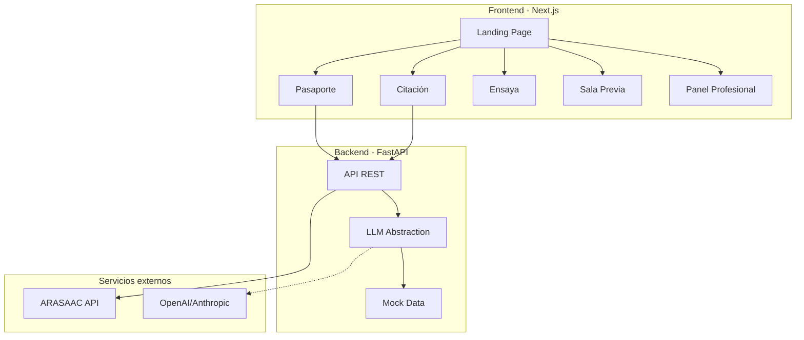

# PUENTE

**De la citación a la sentencia, a tu manera.**

Aplicación de accesibilidad cognitiva para la justicia. Desarrollada en el DATAthon Justicia 2026 (A Coruña, Reto 3: Justicia inteligente para la neurodiversidad).

## Qué hace

Accesibilidad cognitiva para personas con autismo, TDAH, dislexia o ceguera que tienen que ir al juzgado.

- **Citación accesible**: documentos judiciales en lectura clara, lectura fácil, pictogramas y audio
- **Pasaporte de Ajustes**: QR con las adaptaciones que necesitas, sin revelar diagnóstico
- **Ensaya**: practica responder preguntas del juicio
- **Sala Previa**: simulación sensorial por niveles (ruido, luz, gente, eco) con pausa y check-in de confort
- **Panel profesional**: genera el perfil de ajustes (Guía CGPJ 2025)

## Arquitectura



## Ejecutar

### Requisitos

- Python 3.11+
- Node.js 18+
- npm o pnpm

### Backend

```bash
cd backend
python -m venv venv
source venv/bin/activate  # Windows: venv\Scripts\activate
pip install -r requirements.txt
cp .env.example .env
uvicorn app.main:app --reload --port 8000
```

### Frontend

```bash
cd frontend
npm install
npm run dev
```

Abrir http://localhost:3000

### Variables de entorno

Copia `backend/.env.example` a `backend/.env`. Por defecto usa datos mock:

```env
LLM_PROVIDER=mock  # o "openai" / "anthropic" con la API key correspondiente
OPENAI_API_KEY=
ANTHROPIC_API_KEY=
```

## División del equipo

| Persona | Responsabilidad | Tareas principales |
|---------|-----------------|-------------------|
| **A** | IA y backend | Procesamiento de citación, mediador, integración LLM |
| **B** | Frontend persona | Citación, Pasaporte, Ensaya, calendario, voz |
| **C** | Profesional + contenido | Panel, Sala Previa, contenido legal, pitch |

### Checklist por persona

#### Persona A (backend)
- [ ] Endpoint `/api/procesar-citacion` funcionando con mock
- [ ] Integración con ARASAAC para pictogramas
- [ ] Endpoint `/api/generar-ics` para calendario
- [ ] Mediador: análisis de preguntas confusas
- [ ] (Opcional) Conectar LLM real si hay API key

#### Persona B (frontend persona)
- [ ] Flujo completo de citación: pegar → procesar → ver resultado
- [ ] Lectura clara y lectura fácil con toggle
- [ ] Botón leer en voz alta funcionando
- [ ] Pictogramas de ARASAAC mostrados
- [ ] Descarga de calendario .ics
- [ ] Pasaporte: formulario → selección ajustes → QR
- [ ] Ensaya: 3 niveles de preguntas
- [ ] Demo Luis completa

#### Persona C (profesional + contenido)
- [ ] Panel profesional: perfil CGPJ en 4 pasos
- [ ] Sala Previa: navegación por escenas, sliders de estímulos
- [ ] Contenido: fases judiciales, roles, ajustes (revisar JSON en `/data`)
- [ ] Demo Juan completa con modo voz
- [ ] Deck de pitch (usar skill pptx)

## Skills y MCPs

### Skills disponibles

Lee las skills antes de trabajar en cada área:

| Skill | Usar para |
|-------|----------|
| `puente-lectura-facil` | Escribir textos de usuario |
| `puente-accesibilidad` | Cambios en UI |
| `anthropics-frontend-design` | Diseño de componentes |
| `anthropics-pptx` | Crear el pitch deck |
| `superpowers-brainstorming` | Sesiones de ideación |

### MCPs configurados

En `.mcp.json` y `.cursor/mcp.json`:

- **docling**: procesa PDFs de citaciones reales
  ```bash
  # Requiere uv instalado
  uvx --from docling-mcp docling-mcp-server --transport stdio
  ```

- **context7**: documentación de librerías
  ```bash
  npx -y @upstash/context7-mcp@latest
  ```

## Verificar accesibilidad

1. **axe DevTools**: instalar extensión en Chrome, ejecutar en cada página
2. **Navegación por teclado**: Tab para moverse, Enter para activar
3. **Lector de pantalla**: probar con VoiceOver (Mac) o NVDA (Windows)

```bash
# Lighthouse desde CLI
npx lighthouse http://localhost:3000 --only-categories=accessibility
```

## Créditos

- Pictogramas: [ARASAAC](https://arasaac.org), Sergio Palao, Gobierno de Aragón. Licencia CC BY-NC-SA.
- Pautas de lectura fácil: UNE 153101:2018 EX
- Perfil de ajustes: Guía práctica CGPJ (diciembre 2025)
- Comunicación con personas autistas: Guía Autismo España (2025)

## Base legal

- Art. 7 bis LEC y 109/118 LECrim (ajustes de procedimiento)
- Ley 15/2022 (igualdad de trato y no discriminación)
- RDL 1/2013 (derechos de personas con discapacidad)
- Ley 6/2022 (accesibilidad cognitiva)
